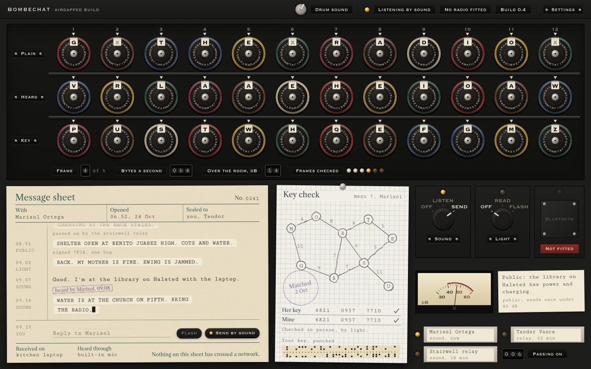
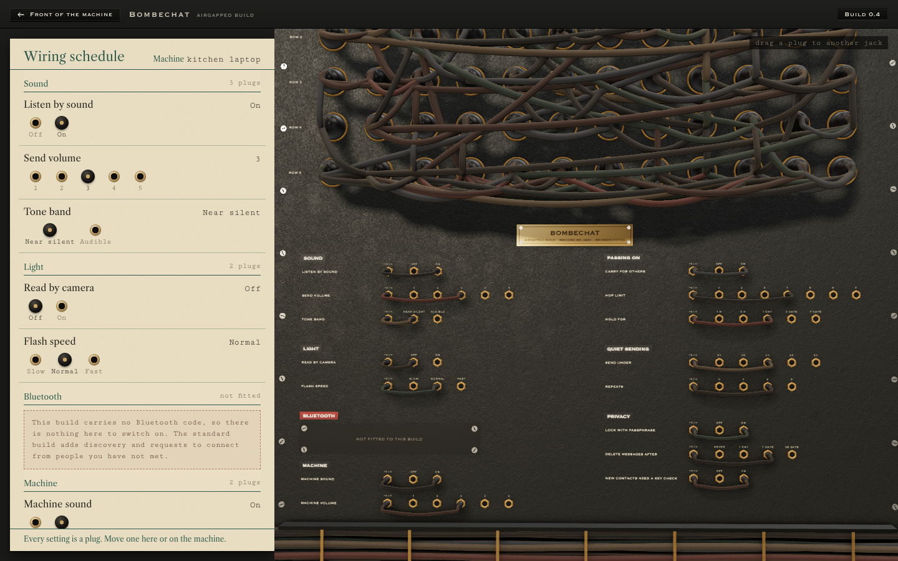

# Bombechat

Bombechat is a messenger that never touches the internet. Messages travel between nearby devices by sound, by light, or by Bluetooth, and can hop from device to device to reach people further away. It is meant for when the network is down, and for when you would rather it not be involved at all.

The first part works: two Macs running the airgapped build can pair and message each other by sound. Light and Bluetooth are still to come. This repo holds the app, the interface mockups it grew from, and the checks I run on both.



## The idea

Most phones and laptops already have what this needs: a speaker and a microphone, a screen and a camera, and usually a Bluetooth radio.

- Sound carries short messages across a room on tones between 17.6 and 19.8 kHz, which most adults can barely hear.
- Light carries them between screens and cameras in line of sight, which makes it the hardest channel to overhear.
- Bluetooth has the longest reach and works on nearly every device.

There is a separate build for airgapped computers. It contains no Bluetooth code at all, so there is nothing to switch off and nothing to trust. Most people will have met in person and swapped keys by flashing a code at each other's camera. On the standard build, a stranger in Bluetooth range can send a request to connect, and nothing is exchanged unless you accept it. Contacts are stored encrypted on the device.

## The interface

The look is taken from the Bombe, the machine Alan Turing designed at Bletchley Park to find each day's Enigma settings. The window is the machine and its paperwork. Three rows of drums show the key, what the microphone heard, and the plain text. When a frame of a message arrives, the drums turn and the top row settles on the words, which are then pasted onto the message sheet as teleprinter tape. Your own replies are typed straight onto the sheet. The key check is a pencil menu on squared paper, the way Bombe menus were drawn.

The drums make a ratchet click for every letter that passes the index and a clunk when they settle. The sound is synthesised in the browser and filtered hard above 7 kHz, so it stays out of the band Bombechat listens on. Click anywhere to allow sound, and use the switch in the title bar to turn it off.

## Settings

Settings live on the back of the machine. The page is a wiring schedule on the left and a 3D view of the machine's rear panel on the right, rendered in WebGL with three.js. The top of the panel is the drum wiring: five rows of connectors with the cable looms running between them and trunks rising out of view. Below that, every setting is a row of jacks with a patch cord. On and off settings have two jacks, and number settings have one jack per value, so a hop limit of 4 means the cord sits in jack 4.

Changing a setting on the card pulls that cord out, carries it along the row and seats it in the new jack, with the camera moving in on that row and the rest of the wiring dimming. You can also drag a plug on the machine itself, or click a jack. Settings are saved in the browser.



Open `mockups/bombechat.html` in a browser to see it move, and use the Settings plate to turn the machine round. The earlier directions, including a spectrogram-based "Cyber" design, are in `mockups/explorations`.

## Checks

Every change to the interface goes through the same check before it counts as done:

```
npm install
npm run check
```

`npm run check` runs both pages. `npm run check:front` and `npm run check:settings` run one each.

`tools/check.cjs` loads the page in Chromium and saves a screenshot of every message frame, close-up crops of each part of the window at double resolution, and a capture of the drums mid-turn. It confirms that the plain-text row settles on the right letters, then renders one drum turn offline and measures it: how many distinct clicks it makes, whether it clips, and how much of its energy falls in the listening band. It also checks four laptop sizes for sideways scrolling, text under 12px and layout shift, and tests scrolling the message sheet, typing a reply, and the turn to the settings page. It fails on any page error.

`tools/check-settings.cjs` runs the settings page in Chrome on the GPU. It sets every setting to a new value and confirms the cord ends up in the matching jack, tests the arrow keys, measures the frame rate, and saves the overview, a focused row, a cord in mid-air and the narrow layout. The output of both goes to `checks/`, which is not committed.

The engraved plates are set in Marcellus SC, with Libre Caslon for the figures. Both are open fonts (SIL OFL, licences beside them) and are embedded in `app/ui/fonts`, so the app asks nothing of the network or of the fonts installed on the Mac.

CI runs `cargo test --workspace` and the airgapped dependency gate (`npm run check:airgapped`, both the clean check and the negative check that a `bluetooth`-featured build fails it). It does not run `npm run check:front` or `npm run check:settings`: both need a GPU-backed Chrome to render the WebGL interface, which the CI runners don't have. Those stay a local gate, run by hand before a change counts as done.

## Build and run the app

The app is a Tauri shell around the interface in `app/ui`. You need Rust and the Tauri CLI (`cargo install tauri-cli`). From the repository root:

```
cd app/src-tauri
cargo tauri build
```

The app lands in `target/release/bundle/macos/Bombechat.app`, at the top of the repository. Open it from there or copy it to `/Applications`. The first time it opens, macOS asks for the microphone; without it nothing can be heard. The first run asks for your name and a passphrase, and keeps its store and settings in `~/Library/Application Support/app.bombechat.airgapped/`.

To look at the interface without building anything, run it in a browser against a simulated conversation:

```
npm run serve
```

and open http://localhost:4810/app/ui/bombechat.html. The browser path never touches the sound card.

`docs/testing/two-laptops.md` is the walkthrough for trying it on two Macs.

## Airgapped build

There is a separate build for airgapped computers, with the `bluetooth` feature on `bombechat-node` off (`cargo build --no-default-features`). `tools/check-airgapped.sh` proves that build's dependency tree carries no Bluetooth or networking crate:

```
npm run check:airgapped
```

It fails and names the offending crate if one shows up. On macOS, once the app binary exists, it also checks with `otool -L` that the binary links no Bluetooth framework; until then it skips that part with a message.
