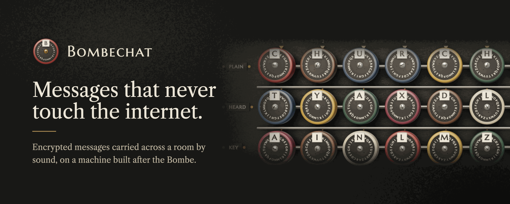
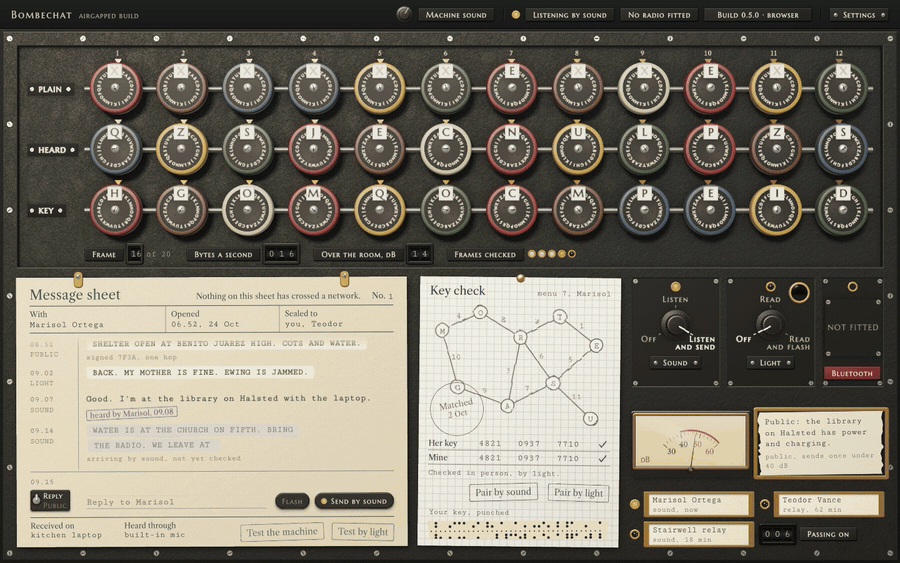
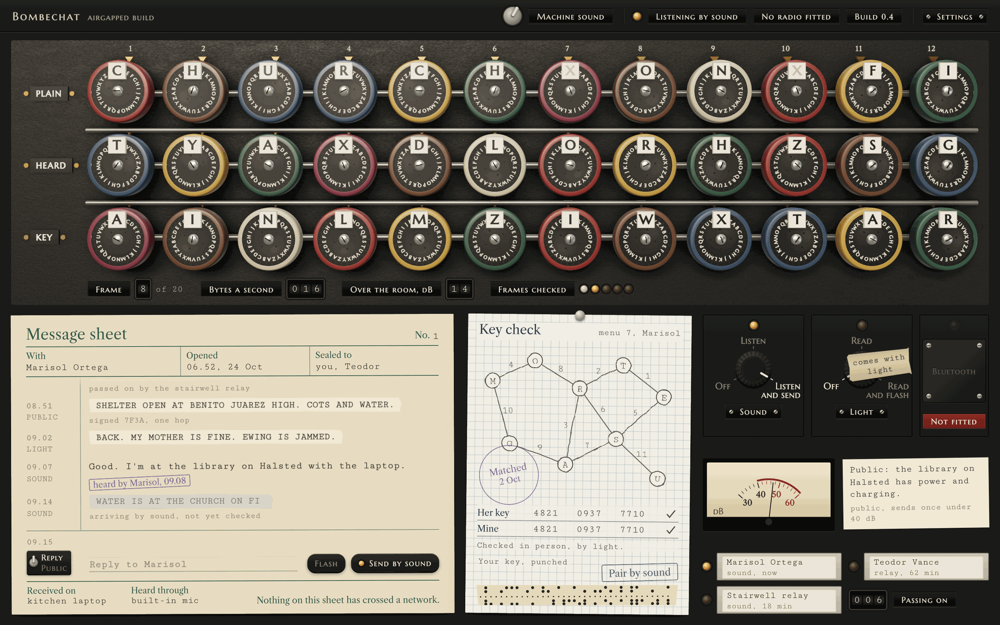
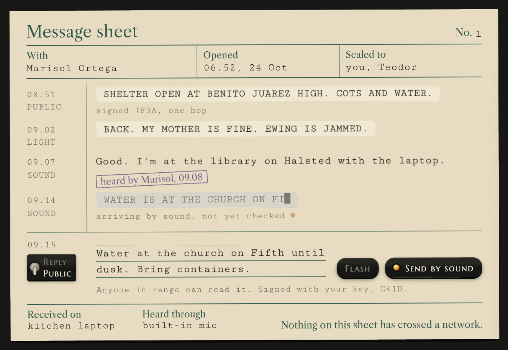
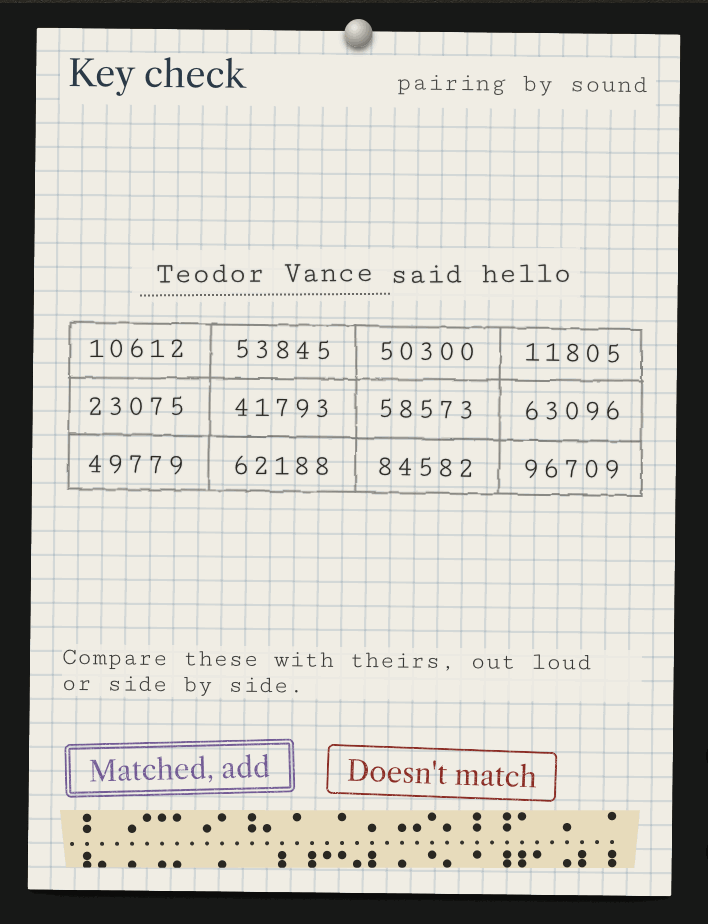
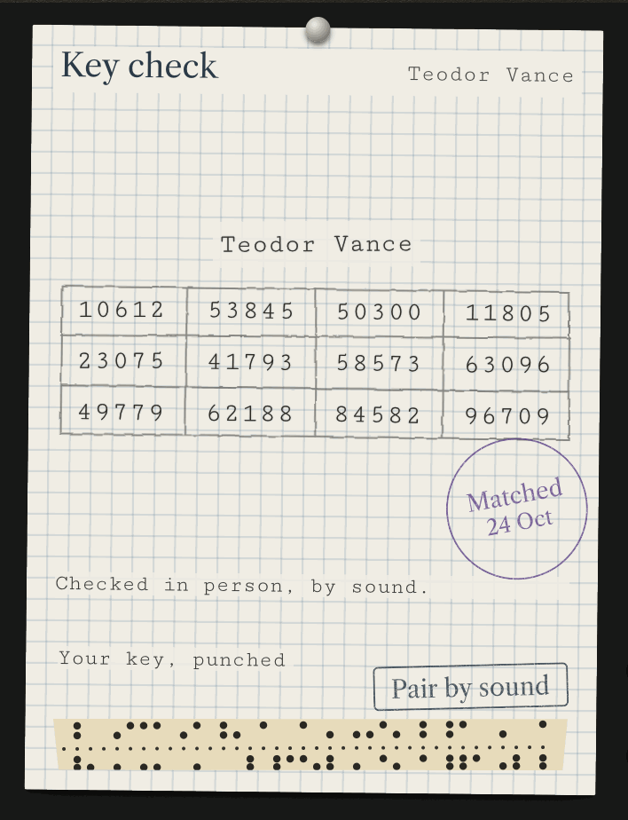
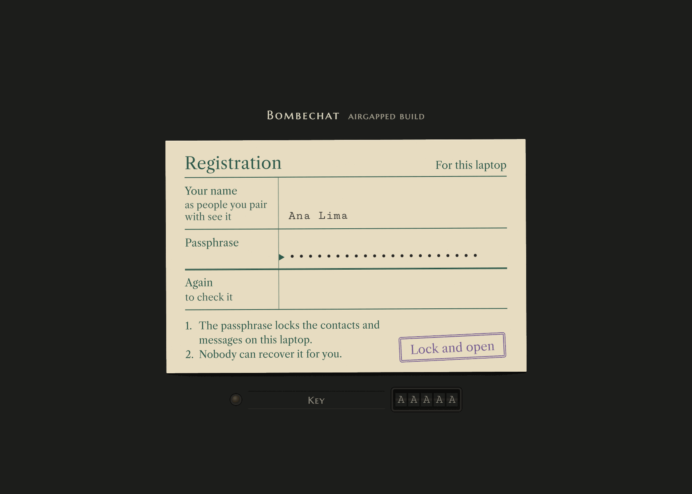
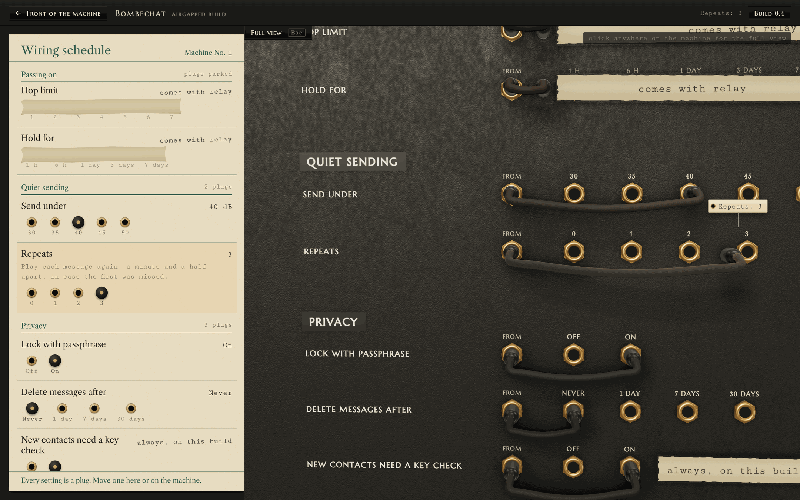

<p align="center">
  
</p>

<p align="center">
  
  
  
  
  <a href="LICENSE"></a>
  <br />
  
  
  
  
  
</p>

<p align="center">
  <a href="#how-a-message-travels">How it travels</a>&nbsp;&nbsp;&nbsp;
  <a href="#the-machine">The machine</a>&nbsp;&nbsp;&nbsp;
  <a href="#pairing-and-safety-numbers">Pairing</a>&nbsp;&nbsp;&nbsp;
  <a href="#privacy-and-the-airgap">Privacy</a>&nbsp;&nbsp;&nbsp;
  <a href="#settings">Settings</a>&nbsp;&nbsp;&nbsp;
  <a href="#build-and-run-it">Build it</a>&nbsp;&nbsp;&nbsp;
  <a href="#checks">Checks</a>&nbsp;&nbsp;&nbsp;
  <a href="#roadmap">Roadmap</a>
</p>

<br />

When the network goes down, so does almost every way of sending a message. And when it's up, every message you send passes through someone else's servers.

Bombechat sends encrypted messages between laptops in the same room by sound. The speaker plays the message on tones high enough that most adults barely hear them, the other laptop's microphone picks it up, and it decrypts on arrival. There is no account, no server and no network code in the build: two Macs with Wi-Fi switched off can pair and talk. It looks and sounds like the machine Alan Turing designed at Bletchley Park to break Enigma.

<p align="center">
  
</p>

The modem carries about **16 bytes a second** on sixteen tones between **17.6 and 19.8 kHz**. Each message is sealed to its recipient with X25519 and XChaCha20-Poly1305, signed with Ed25519, and checked chunk by chunk as it lands, so the drums show it arriving before the last frame is in.

<br />

## How a message travels



You type a reply on the message sheet and press Send by sound. The message is sealed, cut into 48-byte chunks, wrapped in Reed-Solomon parity and played as multi-tone FSK, each transmission starting with a chirp the receiver can lock onto. Before playing, the sender waits until the room is quieter than 40 dB, and by default it plays the message twice more, a minute and a half apart, in case the first was missed.

On the other laptop, the receiver finds the chirp, corrects for the two sound cards running at slightly different speeds, and reads the tones. Every chunk is authenticated the moment it arrives. What has been heard so far is typed onto the sheet as provisional tape, *arriving by sound, not yet checked*, and once the whole message has landed and its signature checks out, it is set in type.

Sound is the first channel. Light, between a screen and a camera in line of sight, is being built on its own branch and is the hardest channel to overhear. Bluetooth is held back for the standard build.

## The machine

The window is a Bombe and its paperwork. Three rows of drums show what the sender wrote, what the microphone caught, and the key you share. When a frame lands, the drums turn to it and the top row settles on the words. The drums are real 3D objects, built in three.js from the same enamel, brass and bakelite as the rest of the machine, and they make a ratchet click for every letter that passes the index and a clunk when they settle. That sound is synthesised in the browser and filtered hard above 7 kHz, so it never leaks into the band Bombechat listens on, and it goes quiet while a message is arriving.



Flip the switch beside the reply line from Reply to Public and the same line writes a public notice instead: unencrypted, signed with your key, readable by anyone in range. It's meant for things like *Water at the church on Fifth until dusk*.

## Pairing and safety numbers

<p>
  
  
</p>

There is no directory to look people up in. Both of you press Pair by sound and each laptop plays a hello carrying its public keys. The key check card then shows a 60-digit safety number, worked out from both keys, in twelve groups of five. Read them to each other out loud. If they match, press Matched, add and the card is stamped. If they don't, Doesn't match keeps nothing.

On the airgapped build this is the only way to add a contact, so every contact has been checked in person.

## Privacy and the airgap

The airgapped build has no networking or Bluetooth code in it at all, so there is nothing to switch off and nothing to trust. `tools/check-airgapped.sh` proves it on every change: it reads the build's whole dependency tree and fails if any Bluetooth or networking crate turns up (`reqwest`, `hyper`, `btleplug` and the rest), and on macOS it checks with `otool` that the built app links no Bluetooth framework. CI also runs it with the `bluetooth` feature switched on and expects it to fail, so the check itself is tested.

- **The store** is SQLCipher, keyed from your passphrase with Argon2id. Contacts, messages and settings stay on the laptop.
- **Deleting** overwrites with zeros. SQLite's `secure_delete` is on, and the space is given back, so a deleted message can't be read again even by someone with the passphrase.
- **Delete messages after** counts only the time the machine has been running, measured on a clock that can't be wound back. Changing the date can't make messages go sooner, and a laptop left closed for a month doesn't wake up to an empty sheet.
- **The interface** asks nothing of the network. The fonts are embedded, three.js is vendored, and the page check fails if the page requests anything off the machine or if an `http` address appears anywhere in `app/ui`.



The first run asks for your name and a passphrase. Nobody can recover the passphrase for you. On a Mac you can take the lock off, and the store key then lives in the macOS Keychain so the app opens without asking. If the Keychain won't keep the key, the lock stays on and the settings say why.

## Settings



Settings live on the back of the machine. Press the Settings plate and the window turns round. On the left is a wiring schedule, and on the right is the rear panel, rendered in 3D. Every setting is a row of jacks with a patch cord in it. On and off settings have two jacks, and number settings have one jack per value, so Repeats at 3 means the cord sits in jack 3.

Change a setting on the card and the camera moves in on that row while the cord pulls out, travels along the panel and seats itself in the new jack. You can also drag a plug on the panel itself, or click a jack. Settings that wait for a later feature, like the hop limit for relay, are taped over with a note saying what they're waiting for.

## Build and run it

You'll need macOS, Rust, Node and the Tauri CLI (`cargo install tauri-cli`).

```sh
git clone https://github.com/AllStreets/bombechat.git
cd bombechat/app/src-tauri
cargo tauri build
```

The app lands in `target/release/bundle/macos/Bombechat.app` at the top of the repository. The first time it opens, macOS asks for the microphone; without it nothing can be heard. Its store and settings live in `~/Library/Application Support/app.bombechat.airgapped/`. `docs/testing/two-laptops.md` walks through trying it on two Macs.

### Or look at it in a browser

The interface runs in any browser against a simulated conversation, with no Rust needed and no sound card involved:

```sh
npm install
npm run serve
```

Then open http://localhost:4810/app/ui/bombechat.html.

## Checks

```sh
cargo test --workspace     # 259 tests: the crypto, the modem, the store, the node and the app's commands
npm run check              # both pages in Chrome on the GPU
npm run check:airgapped    # the dependency gate
```

`npm run check` loads the front and the back of the machine in Chrome and fails on any page error, sideways scrolling at four laptop sizes, text under 12 px, layout shift, a drum row that doesn't settle on the right letters, or a network request. It walks through pairing, public notices and the first run on both the browser path and the app path, sets every setting and checks the cord lands in the right jack, and renders a drum turn offline to measure that the clicks don't clip or leak into the listening band.

CI runs the Rust tests and the airgapped check on Linux and on macOS, where the Keychain is. The page checks need a GPU-backed Chrome, so they run locally before a change counts as done. The pictures in this README are rendered by `node tools/media.cjs` from the same pages.

## Roadmap

- **Light.** Messages flashed from one screen into another laptop's camera. In progress.
- **Relay.** Laptops carry messages for others, so a message can hop across a building or a block to reach someone out of earshot.
- **Bluetooth**, in a separate standard build. A stranger in range can send a request to connect, and nothing is exchanged unless you accept it. The airgapped build stays without it.
- **Phones.** The same machine on iOS and Android.
- **A bridge to Bitchat**, so messages can cross into its Bluetooth mesh.

## License

MIT, copyright 2026 AllStreets. See [LICENSE](LICENSE).

The engraving face is Marcellus SC, with Libre Caslon Text for the forms and Cutive Mono for the typewriter, all under the SIL Open Font License with their texts beside them in `app/ui/fonts`. three.js is vendored under the MIT License in `app/ui/vendor/three`. [NOTICE](NOTICE) lists everything bundled and its license.
